# #8 Device Management: production architecture

This doc covers how #8 runs at **1M+ devices and 1B+ messages/day**, and how that maps onto what's in the repo today.

**Two run modes, one codebase**

| | Zero-infra (dev, default) | Production |
|---|---|---|
| Store | PGlite (embedded Postgres) in `apps/api/data` | TimescaleDB (pg16) + Redis |
| Bus | in-process pipeline | Kafka / Redpanda |
| MQTT | embedded aedes on :1883 | VerneMQ / EMQX cluster, mTLS on :8883 |
| Processes | one `apps/api` process | `ROLE=api` · `ROLE=ingest` · `ROLE=decoder` (same image) |
| Firmware blobs | local disk | S3 / MinIO + CDN |

The domain logic doesn't change between modes. That includes `codec-runtime`, `ops-engine` and the agents. Only the adapters (store, bus, broker) are swapped.

### The 14 modules

Lifecycle, connectivity and health are **independent axes**:
- **Lifecycle:** registered → assigned → installing → pending_activation → activated, plus maintenance / suspended / swap, and retired (history retained).
- **Connectivity:** online / stale / offline / never_seen.
- **Health:** normal / warning / critical.

A device can be `activated` + `stale` + `warning` at the same time, and every screen, KPI and filter treats the three axes separately.

| # | Module | What it covers | API surface (`docs/api-contract.md`) | Runs on |
|---|---|---|---|---|
| 01 | **Overview** | Ops inbox, fleet KPIs, trends | `/ops/inbox`, `/fleet/stats`, `/reports/trends` | API + Timescale continuous aggregates |
| 02 | **Inventory** | Search and filter by org/branch/OEM/model/firmware/asset/dates, KPI cards, CSV export, bulk ops (preview → confirm → per-device results) | `/devices`, `/inventory/kpis`, `/devices/export`, `/devices/bulk*`, `/bulk-jobs` | API + Postgres; bulk jobs on a worker queue |
| 03 | **Lifecycle** | Guarded state machine (`LIFECYCLE_TRANSITIONS`), transfers, lifecycle summary | `/devices/:id/lifecycle`, `/devices/transfer`, `/lifecycle/summary` | API + ops-engine |
| 04 | **Device & Asset Association** | Assets, primary/secondary devices, install / swap / reassign history | `/assets*`, `/assets/:id/swap`, `/assets/:id/associations` | API + Postgres (temporal association rows) |
| 05 | **Configuration** | Desired vs reported config, templates/profiles, drift | `/devices/:id/config`, `/config-templates` | API + Redis shadows + `commands.v1` |
| 06 | **Health & Monitoring** | Health score/level, freshness, battery, signal, GPS, engine hours | `/devices/:id/health` | Decoder → Redis shadow → ops-engine health |
| 07 | **Connectivity & SIM** | Online/stale/offline, SIM status/plan/usage, activate/suspend, link-out to #8 SIM Management | `/devices/:id/sim*`, `/sims` | Edge session state (Redis) + SIM integration |
| 08 | **Firmware & OTA** | Signed firmware, waved campaigns, health gates, rollback | `/firmware`, `/ota/campaigns*` | OTA orchestrator + `ota.v1` + S3/CDN |
| 09 | **Diagnostics & Commands** | Codec-encoded downlinks, ack tracking, decode diagnostics, unknown payloads / re-decode | `/devices/:id/commands`, `/diagnostics/decode`, `/payloads/*` | `commands.v1`, decoder group |
| 10 | **Incidents & Alerts** | Alerts by category (device failure, abnormal telemetry, comms loss, security, OTA), ack/resolve, alert rules | `/alerts*`, `/alert-rules` | Rules consumer on `decoded.v1` |
| 11 | **Audit & History** | Unified device timeline (lifecycle, config, ownership, technician, command, association, security), audit log | `/devices/:id/timeline`, `/audit` | Append-only Postgres tables |
| 12 | **Security & Access** | Per-device X.509/PSK/token credentials, issue/revoke, expiry, tenant-isolation checks | `/devices/:id/credentials`, `/credentials/:id/revoke`, `/security/overview` | API + CA/KMS + broker ACLs (§3) |
| 13 | **Reports & Analytics** | Reliability/uptime, deployment success, OTA success, failures by cause/model, connectivity, utilization | `/reports/fleet` | Timescale continuous aggregates |
| 14 | **Integrations & Automation** | Webhooks, #8 CRM / ticketing / installation / SIM, Kafka & MQTT bridges, automations, AI agents, MCP | `/integrations*`, `/automations*`, `/agents*` | Integration consumer group, agents, `packages/mcp-server` |

---

## 1. Data flow

```mermaid
flowchart LR
  subgraph Edge["Protocol edge (stateless, L4 LB)"]
    MQTT["MQTT 3.1.1/5<br/>VerneMQ/EMQX · mTLS"]
    COAP["CoAP / LwM2M<br/>DTLS · OSCORE"]
    UDP["UDP / TCP<br/>raw sockets"]
    HTTP["HTTP ingest<br/>device tokens"]
    LNS["LoRaWAN bridges<br/>TTS · ChirpStack · Actility"]
  end

  subgraph Bus["Kafka / Redpanda (RF=3, min ISR=2)"]
    RAW[("raw.v1<br/>key=deviceId · 96p")]
    DEC[("decoded.v1<br/>key=deviceId · 96p")]
    UNK[("unknown.v1")]
    CMD[("commands.v1")]
    OTA[("ota.v1")]
    SHD[("shadow.v1<br/>compacted")]
    DLQ[("dlq.v1")]
  end

  subgraph Proc["Stream processing"]
    DECODER["Decoder group<br/>stateless · codec cache<br/>codecId@version"]
    RULES["Automations / alerts<br/>ops-engine"]
    SINK["Integrations<br/>webhooks · CRM · Kafka"]
    OTAE["OTA orchestrator<br/>waves + health gates"]
  end

  subgraph Store["State"]
    TS[("TimescaleDB<br/>hypertables · compression<br/>continuous aggregates")]
    REDIS[("Redis<br/>shadows · last-seen<br/>sessions · rate limits")]
    S3[("S3<br/>firmware · raw archive")]
    REG[("Codec registry<br/>immutable DCS versions")]
  end

  API["API (Fastify)<br/>REST + WS /live"]
  CON["Console (Next.js)"]
  AG["AI agents + MCP server"]

  MQTT & COAP & UDP & HTTP & LNS --> RAW
  RAW --> DECODER
  REG -. load .-> DECODER
  DECODER --> DEC & UNK
  DECODER -. poison .-> DLQ
  DEC --> TS
  DEC --> RULES & SINK
  DEC --> SHD --> REDIS
  UNK --> TS
  RULES --> CMD
  API --> CMD --> MQTT & COAP & LNS
  OTAE <--> OTA
  OTAE --> CMD
  S3 -. presigned URL .-> MQTT
  API <--> TS & REDIS & REG & S3
  API --> CON
  AG --> API
```

### 1.1 Protocol edge
- **One job:** authenticate the device, wrap the payload in a `RawEnvelope` (`packages/dcs-schema/src/codec.ts`) and produce it to `raw.v1`. The edge never decodes, so a codec bug can't take ingest down.
- **MQTT:** topics `dev/{serial}/up[/{port}]`, downlinks `dev/{serial}/down` (raw codec bytes). Acks arrive as codec `*ack*` uplinks, which ack the oldest open command, or via `POST /commands/:id/ack`. The broker cluster (VerneMQ or EMQX) sits behind an L4 NLB. A broker plugin or bridge forwards uplinks to Kafka, and per-device ACLs restrict a client to `dev/{its CN}/#`.
- **CoAP / LwM2M:** Leshan or Eclipse Wakaama server. LwM2M objects (3303 temperature, 5 firmware update) map onto the DCS `semantic` field.
- **UDP / TCP:** `serial|port|hex` frames in dev. In production each device class gets a framing adapter (length-prefixed TCP, NB-IoT UDP with a DTLS PSK).
- **LoRaWAN:** uplinks are webhooks or MQTT integrations from the network server (TTS, ChirpStack, Actility). `fPort` becomes `port`. Downlinks go to the network server's queue API.
- **Idempotency:** `envelope.id` is a ULID. For LoRaWAN, the NS dedups by `fCnt`, and multi-gateway duplicates are dropped by `(devEUI, fCnt)` in Redis with a 60 s TTL.

### 1.2 Event bus (Kafka contract)
| Topic | Key | Partitions (prod) | Retention | Content |
|---|---|---|---|---|
| `raw.v1` | deviceId | 96 | 7 d (+ S3 archive forever) | `RawEnvelope` |
| `decoded.v1` | deviceId | 96 | 3 d | `DecodedEnvelope` |
| `unknown.v1` | deviceId | 12 | 14 d | raw + every candidate's errors |
| `commands.v1` | deviceId | 24 | 7 d | command lifecycle (queued → sent → acked) |
| `ota.v1` | campaignId | 12 | 30 d | wave / device update events |
| `shadow.v1` | deviceId | 96 | compacted | latest reported state |
| `dlq.v1` | — | 12 | 14 d | poison records + exception |

Keying by `deviceId` keeps per-device ordering, which shadows, counters and OTA state machines rely on. Schemas are versioned in the topic name (`.v1`), and envelopes are Protobuf in Schema Registry. Producers use `acks=all`, idempotent producers and zstd compression.

### 1.3 Decoder consumer group
- Stateless workers in consumer group `hash8-decoder`. They scale horizontally up to the partition count.
- **Codec cache:** an LRU keyed `codecId@version`. Entries are compiled `Codec` objects from `@hash8/codec-runtime` (`createCodec`), loaded from the immutable codec registry. Publishing a new version never mutates a cached one, and a device's `codecVersion` decides which entry is used, so rollouts and rollbacks are just pointer moves.
- **Per record:** device lookup (Redis, then Postgres) → decode → `decoded.v1` or `unknown.v1` → batched Timescale insert → shadow update. Offsets are committed only after the batch is durable, which gives at-least-once delivery. Inserts are idempotent on `(device_id, received_at, envelope_id)`.
- **Poison handling:** a record that throws, as opposed to one that fails to decode, is retried 3× and then sent to `dlq.v1`. The partition never blocks.
- **Re-decode:** `POST /payloads/redecode` replays `unknown.v1` and archived raw data through a newer codec version. This is how the payload-triage agent's codec patches get applied to past data.
- **Future, WASM codecs:** `codec-compiler` already emits portable plugins. A WASM target would add sandboxed, language-neutral codecs that can run both in decoders and on edge gateways, with fuel or time limits per decode.

### 1.4 Storage
**TimescaleDB**
- `messages` hypertable, chunked by `received_at`. Use 2 h chunks at 1B/day so each chunk stays under 25 % of RAM. Compress after 24 h with `segmentby = device_id, orderby = received_at DESC`, which typically gets 10–20×. Retain raw rows for 90 d, longer per tenant plan.
- Continuous aggregates: `telemetry_1h` and `telemetry_1d` (min/max/avg/last per numeric field), plus `fleet_health_5m`. Keep these for 2 years and serve the console charts from them.
- Relational tables (`devices`, `models`, `codecs`, `commands`, `ota_*`, `alerts`, `audit`) are plain Postgres with row-level security on `tenant_id`.

**Redis**
- Device shadow (reported + desired), `last_seen`, connectivity, MQTT session routing, per-device and per-tenant token buckets, and dedup keys.
- Shadows are rebuildable from the compacted `shadow.v1` topic, so Redis is a cache and never the source of truth.
- `last_seen` is flushed to Postgres every 60 s, never once per message.

**S3**
- Signed firmware images, behind a CDN with presigned URLs.
- The raw archive: Parquet written hourly from `raw.v1`, used for re-decode and ML.

### 1.5 API, live and console
- Fastify REST (`docs/api-contract.md`). Stateless, HPA on CPU.
- WebSocket `/live` fans out from a Kafka consumer, with per-tenant filtering and sticky routing. The console is Next.js and talks only to the API.
- **MCP server:** `packages/mcp-server` exposes ops tools to Claude and other agents through the same API. Every call is audited as `agent:mcp`.

---

## 2. Multi-tenancy
- **Tenant tree:** OEM → solution provider → customer (`Tenant.kind`). A device has a `tenantId` (current owner) and an `oemTenantId` (manufacturer).
- **Transfer:** `POST /devices/transfer` moves ownership. Codec access travels with the device, so the receiving tenant can decode it without seeing the OEM's other codecs.
- **Isolation:** every envelope carries `tenantId`. Postgres RLS uses `SET app.tenant_id` per request, and API keys and JWTs are tenant-scoped. Each tenant has quotas (devices, msgs/s, storage) enforced at the edge with Redis token buckets.
- **Noisy neighbours:** large tenants can get dedicated partitions, using a tenant-prefixed key via a custom partitioner, or a dedicated decoder deployment. Integrations and webhooks run on a separate consumer group so a slow customer endpoint can't create lag on decode.

## 3. Security
### 3.1 Device identity: mTLS / X.509
- Each OEM gets an **intermediate CA** under the #8 root, with keys in an HSM or KMS. Device certs are issued at factory provisioning (`provisioning: flashed → provisioned`, OEM side, separate from the customer lifecycle), with CN = serial and SAN URI = `urn:hash8:device:{id}`. Keys stay in the device's secure element.
- **Just-in-time registration:** on first connect with a valid chain from a known OEM CA, the device record is created or activated.
- **Revocation:** a CRL/OCSP stapling list pushed to brokers. Moving a device to `retired` or `suspended` revokes it immediately via a broker session kick and an ACL deny.
- **Expiry:** the `cert_expiry` ops-inbox item triggers rotation over the existing mTLS session (EST/`simpleReenroll`) before expiry.
- **Non-TLS transports:** DTLS-PSK or OSCORE for CoAP and UDP. LoRaWAN uses the network server's AppKey/NwkKey, never handled by #8. HTTP uses short-lived device JWTs signed by the device key.

### 3.2 OTA signing
- Each firmware artifact gets a `sha256` and an **ed25519 signature** (`Firmware.signature`). The signing key lives in KMS and is never exported. Signing is a CI step that requires 2-person approval.
- The device verifies the signature against the OEM public key baked into its bootloader **before** flashing, then reports the version. The anti-rollback counter lives in the secure element.
- Campaigns run in waves (canary → 10 % → 50 % → 100 %) with a **health gate** (`maxFailureRate`, `minHealthScore`). The rollout-guardian agent and the ops-engine auto-pause on gate breach. Rollback re-targets the previous signed image.
- A firmware record can require a codec version (`Firmware.codecVersion`). The orchestrator flips the device's codec pointer atomically when the device reports the new firmware, so payloads from the new layout never hit the old codec.

### 3.3 Platform
- TLS everywhere, NetworkPolicies (default deny), non-root read-only containers, secrets via External Secrets, and audit log entries for every mutation (`AuditEntry`), agents included.
- AI agents propose and humans approve: runs that mutate state stop at `awaiting_approval`.

---

## 4. Sizing (back-of-envelope)

**Load**
| | Avg | Peak (×5) |
|---|---|---|
| 1M devices @ 1 msg / 5 min | 3,333 msg/s | 16,667 msg/s |
| **1B msgs/day** | **11,574 msg/s** | **57,870 msg/s** |

Assumed sizes: raw payload ~30 B, `RawEnvelope` on the wire ~200 B (Protobuf, before zstd), and a decoded envelope ~500 B.

**Kafka**
- `raw.v1`: 11.6k × 200 B ≈ 2.3 MB/s avg (≈ 12 MB/s peak), ≈ 200 GB/day before compression, ≈ 60 GB/day after zstd. With RF3 that's ≈ 180 GB/day on disk, ≈ 1.3 TB for 7 days.
- `decoded.v1`: ≈ 100 GB/day compressed. With RF3 and 3 days of retention that's ≈ 0.9 TB.
- Brokers: 3 is enough for throughput. Run 5 for headroom and rack spread (8 vCPU, 32 GB, 4 TB NVMe each).
- Partitions: 96 on the hot topics. At peak that's ≈ 600 msg/s per partition, which is well inside per-consumer capacity. 96 divides evenly into 8 / 12 / 16 / 24 / 32 / 48 consumers. Grow by adding a `raw.v2` topic, not by repartitioning (repartitioning would break per-device ordering).

**Decoders**
- `npm run simulate -- --mode bench` measures pure decode at roughly 10⁵ msgs/s per core for typical DCS layouts, so decode CPU is not the bottleneck.
- Budget about **5k msg/s per vCPU end-to-end**, which includes Kafka (de)serialisation, the device lookup, the produce to `decoded.v1` and batched inserts.
- That works out to **16 pods × 1 vCPU** at average load (~70 % CPU at 11.6k msg/s), with KEDA scaling on lag up to 48 pods for peaks. 1M devices at 1 msg / 5 min needs only 4–6 pods.

**Protocol edge**
- 1M persistent MQTT connections at ~100k per broker node (conservative) means **12 broker nodes** (8 vCPU / 16 GB each), N+2.
- Ingest adapters: ~4k msg/s per vCPU, so 12–16 pods.

**TimescaleDB**
- 1B rows/day at ~300 B/row with indexes is ≈ 300 GB/day uncompressed, or ≈ 20–30 GB/day compressed.
- 90 days of raw rows is ≈ 2.5 TB, and the continuous aggregates add < 100 GB/year.
- Writes: 58k rows/s peak using batched `COPY` (5k rows/batch). That fits one 32 vCPU / 128 GB primary on NVMe, plus 2 read replicas for the API and console.
- Past ~3B/day, shard by tenant across Timescale instances. Alternatively, offload cold raw data to Parquet in S3 and query it with Trino or ClickHouse.

**Redis**
- 1M shadows × ~1.5 KB ≈ 1.5 GB, plus last-seen, dedup and rate-limit keys ≈ 4 GB.
- Run a 3-shard cluster with replicas. Writes are coalesced per device so a device updates at most once per second.

**API / console**
- 6 API pods and 2 console pods. Read load is dominated by aggregates.

---

## 5. Failure modes

| Failure | Blast radius | Mitigation |
|---|---|---|
| Broker node loss | ~1/12 of MQTT sessions reconnect | Clients reconnect with jittered exponential backoff. Connection-rate limits on the LB. The PDB and slow HPA scale-in (`ingest.yaml`) prevent self-inflicted storms. |
| Reconnect storm (cloud/network blip) | Edge CPU spikes, auth backlog | TLS session resumption, admission control (CONNACK 0x97 quota exceeded), staggered keepalives. |
| Kafka broker loss | None (RF3, min ISR 2) | `acks=all`, idempotent producers. The edge buffers ≤ 30 s locally and then sheds load with MQTT 0x97. |
| Decoder crash / deploy | Short lag spike | At-least-once delivery plus idempotent inserts. `maxUnavailable: 1`. Cooperative-sticky rebalancing. |
| Bad codec version | Decode-error or unknown spike for one model | Codec pinned per device, so roll back by moving the pointer. Raw data is retained, so re-decode after the fix. See runbook "decode error spike". |
| Poison record | One record | Retry ×3, then `dlq.v1`. The partition keeps flowing. |
| Timescale primary down | Writes stall, reads served from replicas | Decoders pause (backpressure) and lag grows inside Kafka's 7 d buffer. Patroni failover is under 30 s. |
| Redis loss | Shadows and last-seen stale | Rebuild from compacted `shadow.v1`. Rate limiting fails open per tenant quota. |
| Hot device / runaway firmware | One partition lags | Per-device token bucket at the edge, auto-alert, and the `suspended` lifecycle state. |
| Bad firmware | Canary cohort | Health gate auto-pause, signed rollback image, and a dual-bank bootloader on the device. |
| Clock skew on devices | Wrong time series | Store both `received_at` (server) and the device timestamp (decoded field). Partition time on `received_at`. |
| Region loss | Full outage in region | Active/passive: MirrorMaker 2 for topics, WAL streaming for Timescale, DNS failover for brokers. RPO ≤ 1 min, RTO ≤ 30 min. |

## 6. Observability
- **OpenTelemetry** for traces, metrics and logs, exported over OTLP to a collector, then to Tempo/Jaeger, Prometheus/Mimir and Loki.
- **Trace context:** `traceparent` travels in Kafka record headers, so one uplink has a single trace spanning edge → `raw.v1` → decoder → Timescale/Redis → automation → webhook.
- **Golden signals (RED/USE)**
  - Ingest: msgs/s by transport.
  - Decoding: success ratio by `codecId@version`, unknown-payload rate, `raw.v1` consumer lag (seconds, not offsets).
  - Latency: end-to-end from `received_at` to queryable, command round trip (queued → acked), OTA wave failure rate.
  - Infra: broker connections, Timescale insert latency and compression backlog.
- **SLOs**
  - 99.9 % of uplinks decoded and visible in the API within 5 s.
  - Command delivery p99 < 2 s for online MQTT devices.
  - API p99 < 300 ms.
  - Error budgets drive the pages, not raw thresholds.
- **Logs:** structured pino JSON with `tenantId`, `deviceId`, `codecId@version` and `traceId`. Payload hex is logged only at debug level and never in multi-tenant aggregate logs.
- The **ops inbox** is fed by the same signals: offline cohorts, unknown-payload clusters, rollout gates, cert expiry and config drift become actionable items instead of dashboards.

## 7. Deployment
- `infra/docker-compose.yml` runs the full local stack. `infra/helm/hash8-dm` is the Kubernetes chart: api, ingest, decoder (HPA, or KEDA on lag), console, PDBs, NetworkPolicies, and a ConfigMap and Secret placeholders.
- Stateful services are managed and not bundled in the chart.
- `infra/k6/ingest.js` is the HTTP ingest load test. `tools/simulator` drives realistic fleets over MQTT, HTTP and UDP, and benchmarks decode CPU.
- CI (`.github/workflows/ci.yml`) runs the typecheck and tests per workspace via turbo, the console build, a decode bench smoke run, and lints for compose, helm and the Dockerfiles.
